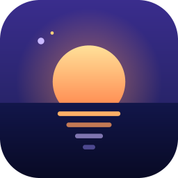

<p align="center">
  
</p>

<h1 align="center">Nocturne</h1>

<p align="center">
  A note-taking app that keeps your notes as plain files in plain folders.<br>
  For Windows, macOS, Linux, iPad and Android.
</p>

## What it is

Nocturne works like the notebook apps you know: notebooks, sections and pages, a ribbon of tools
on top, and a page you type or draw on directly.

The difference is where your notes go. A notebook is a folder. A page is a folder with one text
file (`index.html` or `index.md`) and its pictures beside it. There is no account, no server and
no database. You can open your notes in any editor, back them up by copying a folder, and sync
them with whatever you already use (OneDrive, Dropbox, Syncthing, iCloud).

Nocturne is alpha software. It has had little use and the folder format can still change, so keep
a backup of anything you care about.

## Install

Get the file for your device from the
[latest release](https://github.com/antimajorana/Nocturne/releases/latest).

| Device | File | What to do |
|---|---|---|
| Windows | `windows-x64.msi` | Run it. A portable `.zip` is there too. |
| macOS | `macos-aarch64.dmg` (Apple Silicon) or `macos-x86_64.dmg` (Intel) | Open it and drag Nocturne to Applications. The first time, right-click the app and choose Open. |
| Linux | `.AppImage`, `.deb`, `.rpm` or `.tar.gz` | Run the AppImage, or install the package. |
| iPad and iPhone | `ios-arm64.ipa` | In SideStore or AltStore, add the source below and tap Install. |
| Android | `android-arm64.apk` | Open it and allow the install. |

The SideStore / AltStore source:

```text
https://github.com/antimajorana/Nocturne/releases/latest/download/altstore-source.json
```

The files are not signed, so Windows and macOS warn about an unknown developer the first time.

## What you can do

- Write pages with headings, lists, tables, links, to-do boxes and tags.
- Draw and write by hand with a pen. On an iPad, one finger scrolls and the Apple Pencil draws.
- Add pictures, files, equations and Mermaid diagrams.
- Arrange a page as boxes you can move and resize.
- Choose from 14 light and dark themes.
- Import OneNote files (`.one`, `.onepkg`). Import is not finished yet.

## Where your notes live

| Device | Folder |
|---|---|
| Windows, macOS, Linux | `Documents/Nocturne` |
| iPad and iPhone | Files > On My iPad > Nocturne |
| Android | `Android/data/io.github.antimajorana.nocturne/files/Nocturne` |

Each page is a folder, so pages can sit inside pages as deep as you like.

## Build it yourself

You need [Rust](https://rustup.rs).

```sh
cargo run --release -p nocturne
```

To try it on sample notebooks without touching your own:

```sh
cargo run -p nocturne-cli -- --notebooks ./demo sample
cargo run --release -p nocturne -- --notebooks ./demo
```

## More

- [How-to guides](docs/how-to): writing, drawing, syncing, tags, equations and more.
- [What is missing](docs/gaps.md) and the [roadmap](ROADMAP.md).
- [Contributing](CONTRIBUTING.md), [architecture](docs/architecture.md) and
  [testing](docs/testing.md).
- [Driving Nocturne from a script or an assistant](docs/how-to/drive-it-from-a-script.md).

## Licence

[MIT](LICENSE-MIT) or [Apache-2.0](LICENSE-APACHE), at your option. Third-party notices are in
[NOTICE](NOTICE) and [ATTRIBUTION.md](ATTRIBUTION.md).
