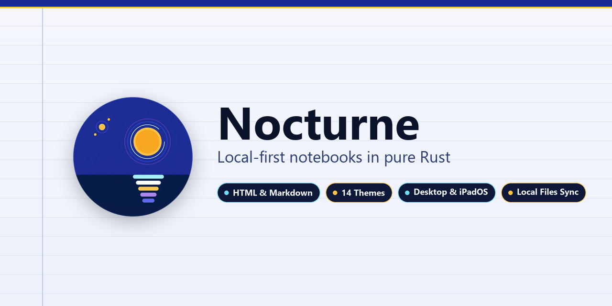
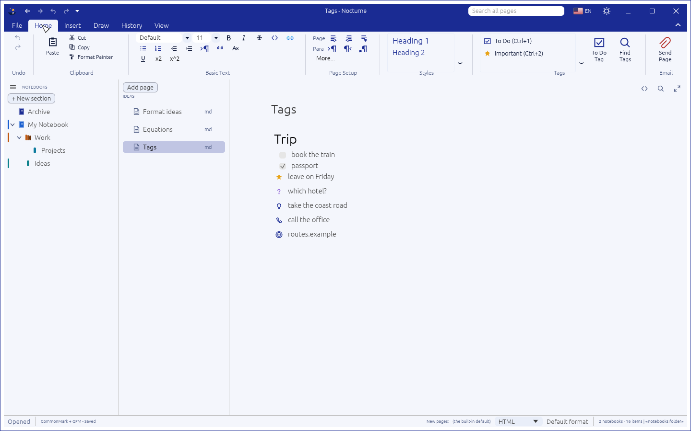
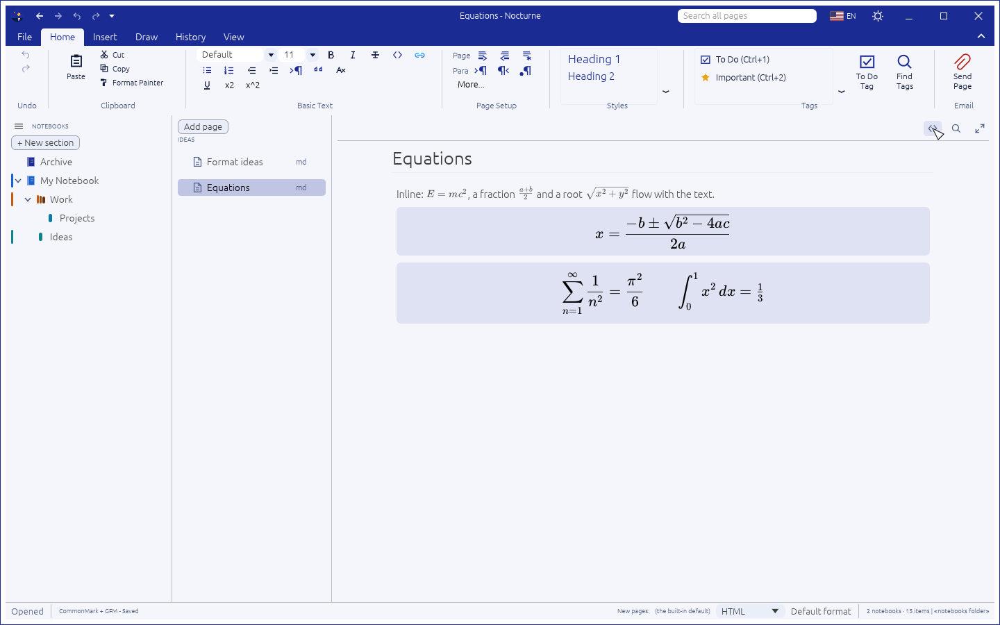
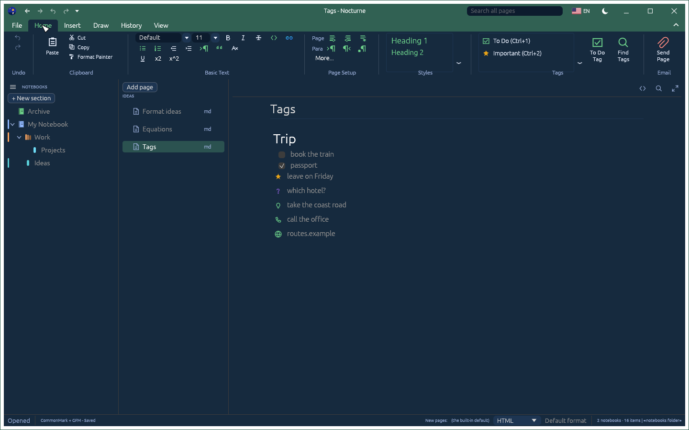
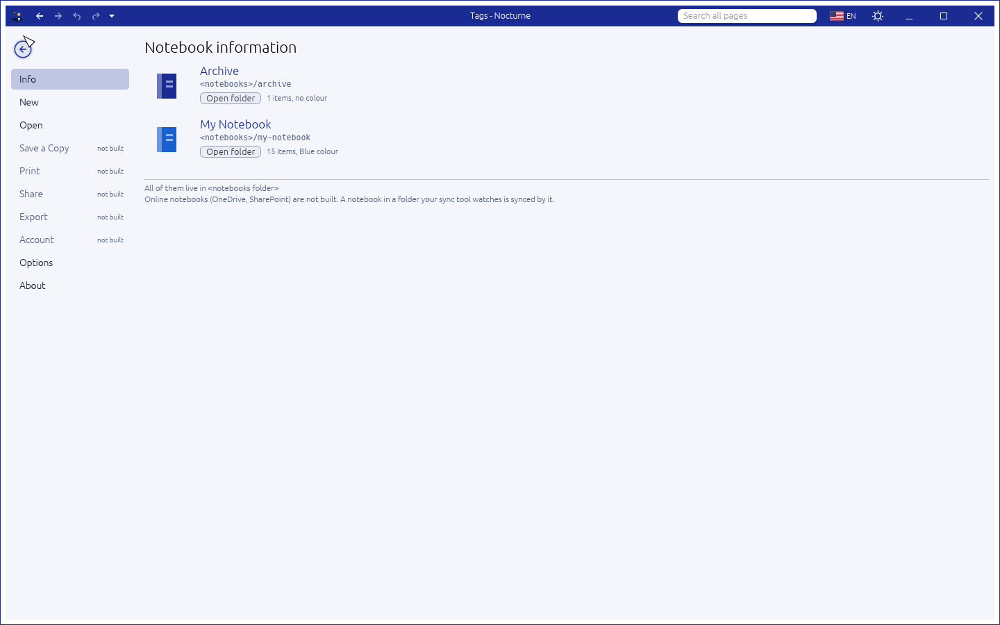
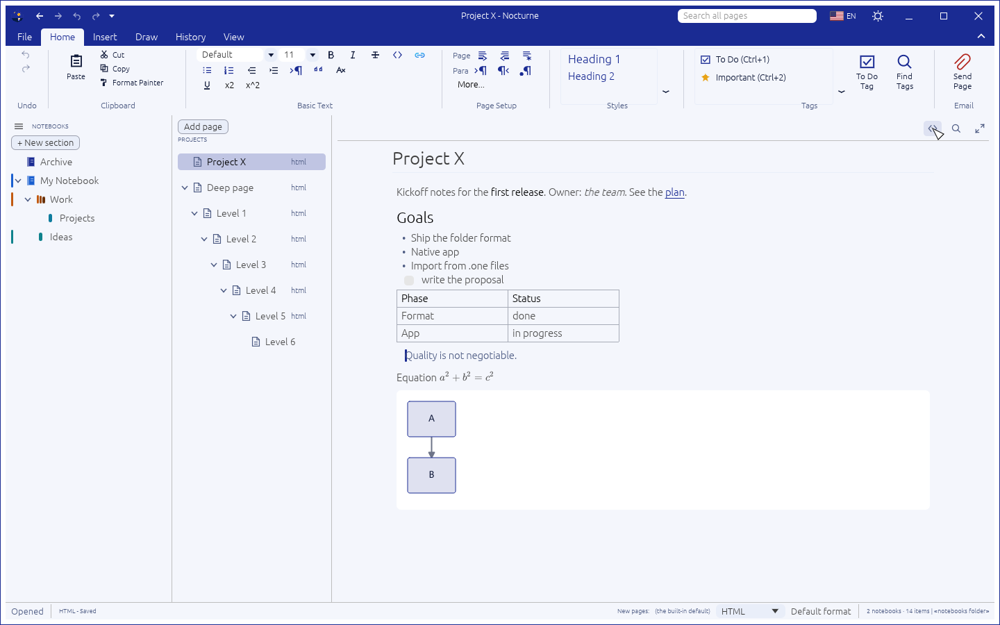
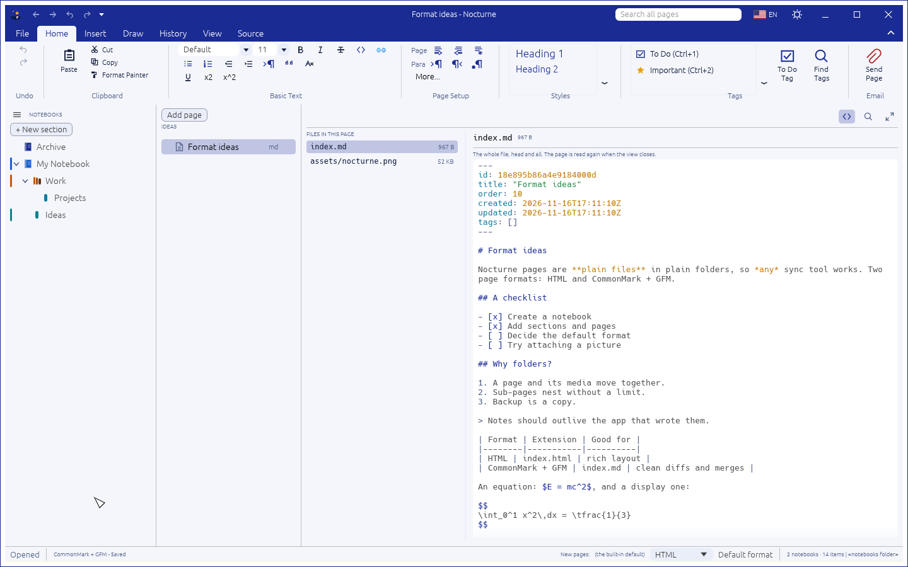
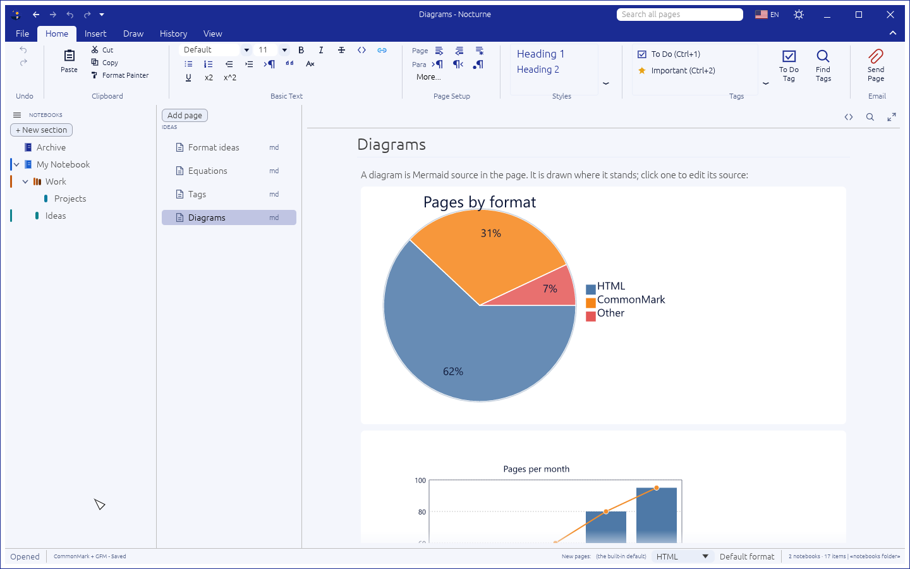

<p align="center">
  <picture>
    <source media="(prefers-color-scheme: dark)" srcset="assets/brand/nocturne-social-dark.png">
    
  </picture>
</p>

<p align="center">
  <b>A clean-room OneNote recreation for local files and sync on your terms.</b>
</p>

<p align="center">
  Nocturne is an open-source, clean-room recreation of the OneNote notebook experience, built around plain local folders and files for Windows, Linux, iPadOS / iOS, and Android. Choose how to sync and back up your notes with tools you already trust, without any server or account.
</p>

<p align="center">
  <a href="https://github.com/antimajorana/Nocturne/actions/workflows/ci.yml"></a>
  <a href="https://github.com/antimajorana/Nocturne/actions/workflows/ios-ipa.yml"></a>
  <a href="https://github.com/antimajorana/Nocturne/releases/latest"></a>
  <a href="docs/coverage.json"></a>
  <a href="docs/coverage.json"></a>
  
  
  
  
</p>

<p align="center">
  
  <br><sub><b>The sample notebooks.</b> The ribbon, coloured notebooks and sections, and a page written in the type it will be read in.</sub>
</p>

<p align="center">
  <a href="#download--install">Download &amp; Install</a> ·
  <a href="#a-tour">A tour</a> ·
  <a href="#why-nocturne">Why Nocturne</a> ·
  <a href="#what-works-today">What works today</a> ·
  <a href="#how-your-notes-are-stored">How your notes are stored</a> ·
  <a href="#build-from-source">Build from source</a> ·
  <a href="docs/how-to">How to</a> ·
  <a href="#for-agents-and-scripts">For agents and scripts</a> ·
  <a href="#architecture">Architecture</a> ·
  <a href="#how-it-is-tested">How it is tested</a> ·
  <a href="#status-and-what-is-missing">Status</a> ·
  <a href="#licence">Licence</a>
</p>

## Download & Install

Grab a pre-built package from the [latest release](https://github.com/antimajorana/Nocturne/releases/latest) (alpha) or install in one line from your terminal:

| Platform | Direct download | How to install |
|---|---|---|
| **Windows (64-bit)** | [`.msi` installer](https://github.com/antimajorana/Nocturne/releases/latest/download/nocturne-0.0.10-windows-x64.msi) · [portable `.zip`](https://github.com/antimajorana/Nocturne/releases/latest/download/nocturne-0.0.10-windows-x64-portable.zip) | Run the `.msi` (or extract the portable `.zip`), or use the PowerShell 1-liner below. SmartScreen: click *More info -> Run anyway*. |
| **iPadOS & iOS (iPadOS 15.0+)** | [`nocturne-0.0.10-ios-arm64.ipa`](https://github.com/antimajorana/Nocturne/releases/latest/download/nocturne-0.0.10-ios-arm64.ipa) · [`altstore-source.json`](https://github.com/antimajorana/Nocturne/releases/latest/download/altstore-source.json) | **SideStore / AltStore** (on-device) or **Sideloadly** (PC / Mac) - see steps below. Files live in *Files > On My iPad > Nocturne*. |
| **macOS (Apple Silicon & Intel)** | [`.dmg` disk image](https://github.com/antimajorana/Nocturne/releases/latest) | Open `.dmg` and drag `Nocturne.app` to Applications (first run: right-click -> *Open*), or use the shell 1-liner below. |
| **Linux (`x86_64` & `ARM64`)** | [`.AppImage`, `.deb`, `.rpm`, or `.tar.gz`](https://github.com/antimajorana/Nocturne/releases/latest) | Run the `.AppImage`, install the `.deb`/`.rpm`, extract `.tar.gz`, or use the shell 1-liner below. |
| **Android (ARM64, Android 8+)** | [`nocturne-0.0.10-android-arm64.apk`](https://github.com/antimajorana/Nocturne/releases/latest/download/nocturne-0.0.10-android-arm64.apk) | Download and install the `.apk` (allow installs from your browser or file manager). |

### 1-line terminal install

**Windows (PowerShell):**

```powershell
irm https://raw.githubusercontent.com/antimajorana/Nocturne/main/packaging/install.ps1 | iex
```

**macOS & Linux (`sh`):**

```sh
curl -fsSL https://raw.githubusercontent.com/antimajorana/Nocturne/main/packaging/install.sh | sh
```

### iPadOS & iOS install

- **Easiest on-device (SideStore / AltStore):** Add source URL `https://github.com/antimajorana/Nocturne/releases/latest/download/altstore-source.json` and tap **Install**.
- **Via PC / Mac (Sideloadly):** Download [`nocturne-0.0.10-ios-arm64.ipa`](https://github.com/antimajorana/Nocturne/releases/latest/download/nocturne-0.0.10-ios-arm64.ipa), drag into Sideloadly, enter your Apple ID, click **Start**, and trust the certificate in *Settings > General > VPN & Device Management*.
- **Where your notes live:** Live notebooks live under *Files > On My iPad > Nocturne* (inside the app's `Nocturne` folder), and `.md`, `.html`, `.one`, and `.onepkg` files can be shared via **Share > Nocturne** or dropped into `Inbox`. See [ios/README.md](ios/README.md) for full details and CI workflow builds ([iOS IPA workflow](https://github.com/antimajorana/Nocturne/actions/workflows/ios-ipa.yml)).

### Desktop, Android, and verification notes

- **Windows:** The `.msi` installs into Program Files (needs administrator rights); the portable `.zip` lets you run `nocturne.exe` directly or `nocturne-setup.exe` for the setup flow. Unsigned builds may trigger Windows SmartScreen (*More info -> Run anyway*). User notebooks stay plain folders under `Documents\Nocturne`, and uninstalling leaves them untouched.
- **macOS & Linux:** On macOS, drag `Nocturne.app` into Applications and right-click -> *Open* on first launch. On Linux, `.tar.gz` archives include `./bin/nocturne-setup`; `.deb`, `.rpm`, and `.AppImage` packages integrate with your desktop launcher.
- **Android:** Notebooks live in app-specific storage (`Android/data/io.github.antimajorana.nocturne/files/Nocturne`), which Android removes with the app. On a phone the window shows the notebooks or the page, one at a time. See [android/README.md](android/README.md) and [docs/gaps.md](docs/gaps.md).
- **Checksums & nightly alpha:** Every release is an alpha, and nightly releases are marked latest on GitHub. Verify downloads against `SHA256SUMS.txt` (or `.ipa.sha256`), or with `gh attestation verify <file> --repo antimajorana/Nocturne`. See [docs/releasing.md](docs/releasing.md).

## A tour

Every picture below is Nocturne itself, drawn off screen by its own test harness
(`cargo xtask screenshots`), not a mock-up.

<table>
<tr>
<td width="50%" valign="top"><p align="center"><sub><b>Home.</b> An Office-style ribbon: groups, galleries for styles and tags, and the controls that are not built yet say so.</sub></p></td>
<td width="50%" valign="top"><p align="center"><sub><b>Tags.</b> To Do, Important, Question, Idea and the rest, written into the page as plain text and drawn as the marks you already know.</sub></p></td>
</tr>
<tr>
<td width="50%" valign="top"><p align="center"><sub><b>Equations.</b> A TeX subset drawn natively: fractions, roots, sums, integrals and scaled brackets.</sub></p></td>
<td width="50%" valign="top"><p align="center"><sub><b>14 themes.</b> Light and dark, seven accents each, every colour checked for contrast by a test.</sub></p></td>
</tr>
<tr>
<td width="50%" valign="top"><p align="center"><sub><b>File.</b> Your notebooks and where they live on disk. Anything not built says so instead of hiding.</sub></p></td>
<td width="50%" valign="top"><p align="center"><sub><b>Both formats.</b> A page is HTML or CommonMark; the same editor, the same look, the file stays in its own format.</sub></p></td>
</tr>
<tr>
<td colspan="2" valign="top"><p align="center"><sub><b>Inside a page.</b> The files a page owns, and what is in each: the whole page file, head and body, to read and to edit.</sub></p></td>
</tr>
<tr>
<td colspan="2" valign="top"><p align="center"><sub><b>Diagrams and charts.</b> Mermaid source in the page, drawn where it stands; click one to edit it: flowcharts, sequence, pie, bar and line, and more.</sub></p></td>
</tr>
</table>

## Why Nocturne

- **Your notes are files.** A notebook is a folder. A page is `index.html` or `index.md` with its
  pictures beside it. Open them in any editor, grep them, put them in git, or delete the app.
- **You can look inside.** A OneNote section is one binary file, and a text editor shows noise.
  Nocturne's page source view lists every file a page owns and shows what is in each, the page's
  own text with its head, the drawing, the pictures, so you can check what your notes contain
  without taking anyone's word for it. See [Look inside a page](docs/how-to/look-inside-a-page.md).
- **Sync is your sync.** Put a notebook in the folder OneDrive, Dropbox, Syncthing or iCloud
  already watches. There is no Nocturne server and no account.
- **No depth limit.** Note taking apps usually cap sub-pages at a level or three, because their
  file format says so. Here a page is a folder, so pages nest as deep as you like.
- **Familiar.** The Office-style ribbon, the File screen, coloured notebooks and sections, tags,
  to-do boxes, a page you write on directly. Nothing new to learn.
- **Fast and small.** One Rust binary on the GPU through [egui](https://github.com/emilk/egui).
  No Electron, no browser engine, no database.
- **Scriptable.** Every action is a command with an id, shared by the window, a command line, a
  loopback control channel and an MCP server, so an assistant can use your notes without a
  cloud account.
- **Honest.** Everything unfinished is written down in [docs/gaps.md](docs/gaps.md) and
  [ROADMAP.md](ROADMAP.md). The app says "not built" where it means it.

## What works today

| Area | What you get |
|---|---|
| **Structure** | Notebooks, section groups, sections and pages as folders; sub-pages to any depth; expand and collapse at every level; a new notebook starts with a section and a page, the way you expect |
| **Writing** | Write straight on the page in its finished look: headings, bold, italic, links, quotes, lists. Enter splits the line at the caret, Tab indents a list item, Backspace joins lines |
| **Two formats** | HTML (the default) and CommonMark + GFM, chosen per page, per section, per notebook or globally; the file keeps its own format when you edit it |
| **Containers** | A page is a sheet of boxes, not one column: move a box by the bar on top, resize it by the right edge; select one whole to cut, copy or delete it; each box is an element in the page's own text |
| **Page source** | The `< >` button opens the page's folder: every file the page owns on the left, the one you pick on the right. The page file shows its head (id, title, dates) above its body, which you can edit; a drawing's SVG shows as text, pictures as pictures, and a file nothing on the page uses is marked |
| **Right to left** | Arabic, Hebrew and the rest draw, with a direction for the page, the line or the run, kept in the text itself so it travels. Mixed lines are not reordered yet |
| **Tags** | To Do, Important, Question, Remember, Definition, Highlight, Contact, Address, Phone, Web site, Idea, Critical: stored as plain text in the page, drawn as the marks you know |
| **Diagrams and charts** | Mermaid diagrams, in a fenced block (Markdown) or `<pre class="mermaid">` (HTML), drawn in the page where they stand: flowcharts, sequence, class, state, ER, Gantt, mind maps, pie, bar and line charts. Click one to edit its source. A diagram that cannot be drawn says why and stays as text |
| **Equations** | KaTeX-style TeX maths drawn natively in real maths fonts, inline and display: fractions, roots, sums, integrals, matrices, cases, accents, with a gallery to start from |
| **Pictures and files** | Drop a file on the page: copy it into the page's folder or link to it where it is, and it asks which |
| **Colours** | Nine colours for notebooks, section groups and sections, saved in the folder |
| **Themes** | 14 themes, light and dark in seven accents, with contrast guaranteed by a test; a sun or moon switcher |
| **Finding things** | Search across every page of every notebook, with snippets |
| **Ribbon** | Home, Insert and View, with a Source tab that appears with the page source view; a File screen for whole notebooks |
| **Safety** | Autosave through a temporary file and a rename; a checker for the folder rules; every command tested against junk parameters |
| **Agents** | An MCP server on stdin and stdout: the tree, search, reading and writing pages, making notebooks, running any command; with the window open it can also see what you see |
| **Import** | `nocturne-cli import onenote` turns a folder of `.one` section files, the ones the Office note taking app writes on Windows, into notebooks, sections, pages and sub-pages in either page format, with pictures and attachments. Ink and password protected sections are not read yet |
| **Platforms** | Native Rust + egui/wgpu apps for Windows x64, macOS (Apple Silicon & Intel), Linux x64/ARM64, iPadOS / iOS arm64 (Metal, Files app sync, UIPasteboard, Share-sheet / Inbox import), and Android arm64 |

The honest picture is in [docs/feature-parity.md](docs/feature-parity.md) (feature by feature
against the app most people are moving from) and [docs/gaps.md](docs/gaps.md) (what is missing
or unproven).

## How your notes are stored

```text
Notes/                        the notebooks folder
  my-notebook/                notebook          _node.toml
    work/                     section group     _node.toml
      projects/               section           _node.toml
        project-x/            page              index.html + assets/
          index.html
          assets/diagram.png
          meeting-notes/      sub-page          index.md + assets/
    ideas/                    section           _node.toml (format = "cmgfm")
      format-ideas/
        index.md
```

A page carries its own metadata (title, id, order, created, updated) in front matter or in
`<meta>` tags, so a page is still a page after it is copied, moved or synced. The rules, down to
name length and conflict copies, are in [docs/folder-format.md](docs/folder-format.md).

## Build from source

You need [Rust](https://rustup.rs).

```sh
cargo run --release -p nocturne                      # the app, on ~/Documents/Nocturne
cargo run --release -p nocturne -- --notebooks ./my-notebooks
```

Try it on sample notebooks without touching your own:

```sh
cargo run -p nocturne-cli -- --notebooks ./demo sample
cargo run --release -p nocturne -- --notebooks ./demo --expand-all
```

To try the Welcome demo notebook from its generated release files, first copy one format into the ignored `./my-notebooks`
folder. The copy task never writes to `docs/demo/DemoNotebook`:

```sh
cargo xtask demo-copy html
cargo run -p nocturne -- --notebooks ./my-notebooks --expand-all
```

Use `cargo xtask demo-copy cmgfm` for the CMGFM version. `cargo xtask demo` rebuilds the official
demo and checks the HTML scratch copy, but never overwrites a changed scratch notebook. If it
reports drift, review the changes and explicitly approve replacement with
`cargo xtask demo-copy html --replace`; this replaces edits made to that copy.

## For agents and scripts

Every user-visible action is a command with an id, and every front end dispatches the same ones:

```sh
nocturne-cli commands                                  # every command and its parameters
nocturne-cli run notebook.create name=Work
nocturne-cli run node.create parent=work kind=page title="First page"
nocturne-cli tree
nocturne-cli search "quarterly"
nocturne-cli check work
```

The running window can be driven over a loopback port, which is how the screenshots above are
made and how the UI tests work:

```sh
nocturne --control 0        # prints nothing; the port and key are in control-key.local-PORT
```

It speaks JSON lines: `engine.execute`, `ui.open`, `ui.caret`, `ui.click`, `ui.key`, `ui.text`,
`ui.theme`, `ui.screenshot`, `ui.inspect`. See [docs/control-protocol.md](docs/control-protocol.md)
and the command list in [docs/commands.md](docs/commands.md), which a test keeps in step with the
code.

An assistant reaches the same commands over the **Model Context Protocol**, on stdin and stdout:

```sh
nocturne-cli mcp                  # the notebooks folder, nothing running
nocturne-cli mcp --connect 54321  # a running window, so it sees what you see
```

Tools for the tree, search, reading and writing pages, making notebooks and nodes, checking a
notebook, and running any command by id; resources for the tree, the commands and any page.
Deleting is not a tool of its own. It is stdio only: no network, no account, nothing uploaded.
See [docs/mcp.md](docs/mcp.md).

## Architecture

A Cargo workspace in layers. `cargo xtask layers` enforces that a crate only depends on lower
layers, and that nothing below the UI layer knows about egui.

| Layer | Crate | Job |
|---|---|---|
| L0 | `nocturne-model` | Node kinds, page formats, tags, name rules, ids, time |
| L1 | `nocturne-formats` | HTML and CommonMark: front matter, parsing into blocks, writing blocks back |
| L1 | `nocturne-math` | TeX maths typeset into drawing items (RaTeX, with a small engine of its own as the fallback) |
| L1 | `nocturne-diagram` | Mermaid diagram layout and SVG rendering |
| L1 | `nocturne-onenote` | Reads `.one` section files: the revision store and its objects |
| L2 | `nocturne-store` | Notebooks as folders: the tree, pages, attachments, settings, search, the checker |
| L4 | `nocturne-engine` | The session and the command registry |
| L5 | `nocturne-import` | Importers for `.one` sections and `.onepkg` packages |
| L5 | `nocturne-mcp` | Model Context Protocol stdio server over engine and window commands |
| L6 | `nocturne-ui-egui` | The window: tree, ribbon, the page and how it is written on, Nocturne themes |
| apps | `nocturne`, `nocturne-cli`, `nocturne-setup`, `nocturne-ios`, `nocturne-android` | Desktop, CLI, setup helper, iPadOS / iOS, and Android apps |
| tools | `xtask` | `cargo xtask ci` and workspace audits |

More in [docs/architecture.md](docs/architecture.md). Guides for using it are in
[docs/how-to](docs/how-to): starting a notebook, writing a page, tagging a line, adding
pictures, syncing, choosing the page format, making it yours, scripting it, and moving your
notes in with the importer.

## How it is tested

```sh
cargo xtask ci     # fmt, clippy -D warnings, every test, layers, assets, links, text style
```

The test suite covers:

- **Paired pixel tests.** Every icon is drawn by the app and by an independent reference in the
  same run and compared pixel for pixel, with negative controls that must fail. No golden images
  are committed, so nothing has to be regenerated on another machine.
- **A real window, driven headlessly.** The UI tests open the window off screen, click, type and
  read the page back through the control channel.
- **Contrast.** Every text and accent colour in all 14 themes is checked against its background.
- **Hostile input.** Every command runs with empty, huge, traversal and absolute-path parameters;
  the Markdown, HTML, TeX and `.one` readers are run on junk. Nothing may panic.
- **Round trips.** What the block writer writes, the parser reads back the same, for both page
  formats, so editing a page cannot quietly change it.
- **The MCP server over a pipe.** A whole conversation, from `initialize` to a notebook made,
  written, searched and checked, runs through the same stdio loop a client would use.

[docs/testing.md](docs/testing.md) explains the testing method in detail.

## Logs

The desktop app writes `nocturne.log` next to its settings: `%APPDATA%\Nocturne\` on Windows. A
start from the Start menu has no terminal, so this file is what to attach to a bug report. It
records the start (version, folders), the window opening and closing, warnings and errors from the
graphics and window libraries, and any panic with its backtrace. Page text is not logged on
purpose, but a panic message can quote what the code was handling, so look before you share it. A log
over 1 MB moves to `nocturne.log.old`. `nocturne --version` and `nocturne-cli --version` print
the version and write no file.

## Status and what is missing

Nocturne is **alpha**, version 0.0.10. It is not a finished product yet: it builds, runs and passes
automated checks, but it has had limited field use and notebooks you care about should always have a
backup. The folder format can still change before 0.1. What is missing or in progress:

- Built and run on **Windows and Linux**; **iPadOS / iOS** builds on `macos-15` CI with an automated iPadOS Simulator smoke test (physical iPad testing ongoing). **macOS** and **Android** packages build in CI; native hardware testing is ongoing.
- **Right-to-left text is half there.** Arabic and Hebrew draw, and a page, a line or a run
  can be given a direction. A line that mixes the two directions is still drawn in one order,
  and the window is not mirrored. Measured, not assumed; the stages are in the roadmap.
- The caret belongs to egui, so **there is no selection across blocks**.
- **Import** runs via `nocturne-cli` or the iPadOS Inbox / Share sheet, and does not read ink, tags or password protected sections yet.
- **Mermaid diagrams** are drawn in the page, and a click opens the source. They are drawn with a young renderer that is pinned to one version, and a very large one is refused.

**Versions.** The version on `main` is 0.0.10. Releases follow semantic versioning (`MAJOR.MINOR.PATCH`, still `0.x`, tags like `v0.1.0`, and `-rc.1` for pre-releases). See [Releases](https://github.com/antimajorana/Nocturne/releases) and [docs/releasing.md](docs/releasing.md).

[ROADMAP.md](ROADMAP.md) has the order of work; [docs/gaps.md](docs/gaps.md) is the full list.

## Licence

Nocturne is a clean-room project. The `.one` reader is built from Microsoft's published
specifications ([MS-ONESTORE] and [MS-ONE]) and from using the app that writes those files,
never from its code or its assets. The notes behind the format work are in [docs/research](docs/research).

Window icons are drawn in code, and bundled fonts come from [egui](https://github.com/emilk/egui).
Everything in `assets/` and `docs/images/` has a row in [ATTRIBUTION.md](ATTRIBUTION.md) saying
where it came from, and `cargo xtask assets` checks that nothing is unattributed.

Nocturne is dual-licensed under [MIT](LICENSE-MIT) or [Apache-2.0](LICENSE-APACHE), at your
option. Required third-party notices and attributions are listed in [NOTICE](NOTICE) and
[ATTRIBUTION.md](ATTRIBUTION.md).
